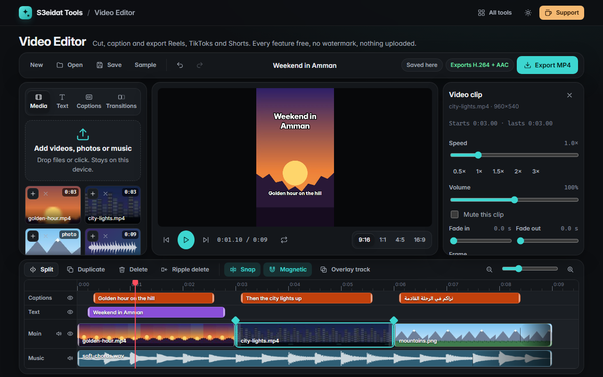

# Video Editor

> Cut, caption and export short videos for Reels, TikTok and Shorts. Free, private, no watermark, and it runs entirely in your browser.

### ▶ [Open Video Editor](https://s3eidat.github.io/video-editor/)



A free alternative to short-video editors like CapCut, without the account, the Pro badges or the export watermark.

## Features

- **Media bin**: drop or pick videos, photos and music; thumbnails, film strips, waveforms and durations
- **Multi-track timeline**: magnetic main track, overlay video tracks (picture in picture), text, captions and music;
  zoom (Ctrl+wheel), playhead scrubbing, snapping to clips and the playhead, drag to move or reorder, drag between tracks
- **Edit**: trim handles, split at the playhead, delete, ripple delete, duplicate, undo / redo
- **Clips**: speed 0.25×–4× (pitch kept in the export), volume 0–200 %, mute, fade in / out, fit or fill, size and position
- **Photos**: any duration, optional Ken Burns zoom in / out
- **Text**: 8 ready styles (title, box, lower third, neon, typewriter, Arabic title…), fonts on your device including Arabic,
  automatic right-to-left, outline / box / shadow / glow, colours, alignment, position, in / out time, fade / pop / slide / typewriter animations
- **Captions**: type them one by one, paste a script and spread it over the video, or import an `.srt`
  (for captions from speech, the free [Transcribe](https://s3eidat.github.io/transcribe/) tool makes one on your device);
  4 auto styles, size, height, pop-in; export `.srt`
- **Transitions**: crossfade, dip to black, flash, slide, per cut or on every cut
- **Canvas**: 9:16, 1:1, 4:5, 16:9 with a blurred-clip or solid background
- **Music**: its own track, fades, and ducking that lowers it while your clips have sound
- **Preview**: play / pause, loop, frame stepping, J / K / L shuttle
- **Projects**: autosaved in this browser (media included, in IndexedDB); save / open `.s3video` files, which re-link media by name
- **Export MP4**: 720p or 1080p, 24–60 fps, progress and cancel, **no watermark**. Uses H.264 + AAC when the browser
  has them, otherwise VP9 / AV1 + Opus. If a browser can't encode video at all, it says so instead of failing.

## Privacy

Your clips never leave your device. Decoding, editing and encoding all happen in the browser (WebCodecs); there is no server,
no account, no analytics. The page ships with a strict Content-Security-Policy (`connect-src 'self'`), so the browser
itself blocks any attempt to send data anywhere.

## Browser support

Editing works in any current browser. Exporting needs WebCodecs video encoding: current Chrome, Edge, Opera and other
Chromium browsers (desktop and Android), Firefox 130+ on desktop, Safari 26+. Long or 4K sources need plenty of memory:
the whole file is read into memory while exporting.

## Run it yourself

It's plain HTML, CSS and JavaScript with no build step:

```bash
git clone https://github.com/s3eidat/video-editor
cd video-editor
python -m http.server 8000
```

Then open http://localhost:8000.

Libraries: [MP4Box.js](https://github.com/gpac/mp4box.js) (BSD-3, MP4 demuxing) and [mp4-muxer](https://github.com/Vanilagy/mp4-muxer) (MIT), both in `lib/`.

## Support

If this saved you time, **[buy me a coffee ☕](https://s3eidat.github.io/coffee/)**. It keeps every tool free.

---

Part of **[S3eidat Tools](https://s3eidat.github.io/)**: 100+ free, private tools that run in your browser. MIT licensed.
